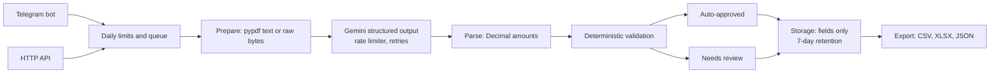

# invoice-pilot

Telegram bot and HTTP API that extract invoice fields with an LLM, check them with deterministic rules and send doubtful documents to a human. For teams that process supplier invoices and want automatic approval only when the numbers add up.

**Live demo:** [@Invoice_Pilot_DemoBot](https://t.me/Invoice_Pilot_DemoBot) (synthetic invoices only)

[](https://github.com/folivia00/invoice-pilot/actions/workflows/ci.yml)
[](LICENSE)

## Results

Measured on the synthetic dataset v1.0 (120 invoices). The table is generated from
`eval/results/*/metrics.json`, and CI fails if it differs from a fresh replay.

<!-- eval:start -->
| Configuration | Model | Docs | Precision among auto-approved | Auto-approved | All key fields correct (model only) | Corrupted caught | Cost / 1,000 invoices |
|---|---|---:|---:|---:|---:|---:|---:|
| gemini-flash-lite | gemini-3.5-flash-lite | 120 | 97.1 % (101/104) | 86.7 % (104/120) | 96.7 % (116/120) | 100.0 % (15/15) | $1.71 |
<!-- eval:end -->

- Corrupted invoices caught with the expected issue code: 100.0 % (15/15). Clean invoices sent to review: 0.9 % (1/105).
- Model call latency: median 2.3 s, p95 4.4 s (120 recorded calls, from `predictions.jsonl`).
- Run of 2026-10-30 on the Gemini API free tier. Cost uses the actual token counts at paid-tier list prices.
- "Precision among auto-approved" is the main metric: the share of automatically approved invoices with every key field right.

## Try it in 60 seconds

Open [@Invoice_Pilot_DemoBot](https://t.me/Invoice_Pilot_DemoBot), press Start and send one of the sample files:

| File | What you should get |
|---|---|
| [inv-001.pdf](examples/invoices/inv-001.pdf) (text PDF, USD) | approved, no issues |
| [inv-005.jpg](examples/invoices/inv-005.jpg) (photo, JPY) | approved, amounts without minor units |
| [inv-007.pdf](examples/invoices/inv-007.pdf) (text PDF, USD) | needs review: `total_mismatch`, the printed total is not subtotal + tax |

Then try `/export` (CSV or XLSX) and the JSON button under a result.

> **Synthetic invoices only.** The demo uses the Gemini API free tier, where Google may use
> inputs to improve its products. Do not upload real or confidential documents.

## Features

- **Inputs:** text PDF, scanned PDF and photo (JPEG, PNG), up to 5 pages. The file type comes from its signature. Text PDFs are sent as extracted text; scans and photos go to the model as the original bytes.
- **Structured output:** the model answers in a strict JSON schema. The answer is parsed into `Decimal` amounts and validated by pydantic. An unusable answer gets one retry, then the invoice goes to review.
- **Deterministic checks:** required fields, currency code, negative values, line amount = quantity × unit price, subtotal = sum of lines, total = subtotal + tax, tax amount = subtotal × rate, tax rate range, zero total, due date before the invoice date, invoice date in the future, IBAN check digits and length, VAT ID / EIN format.
- **Review reasons:** each issue has a code, a field and a message, shown to the user and returned by the API.
- **Export:** CSV and XLSX (amounts as numbers), plus a JSON file per document.
- **HTTP API and n8n:** `POST /extract` with the same pipeline ([docs/api.md](docs/api.md)), and ready-made n8n workflows ([examples/n8n](examples/n8n/)).
- **Limits:** a daily document limit per user and in total, a daily LLM budget in USD, a processing queue and a requests-per-minute limiter for the model API.
- **Privacy:** files stay in memory, only the extracted fields are stored, they are deleted after 7 days, and logs carry no document content.

## Architecture



Modules, data flow and design decisions: [docs/architecture.md](docs/architecture.md). Token usage and cost by input type: [docs/costs.md](docs/costs.md).

## How the numbers are measured

- **Dataset v1.0:** 120 synthetic invoices: 48 text PDFs, 36 scans and 36 photos; 72 English and 48 German; 10 layouts; 5 currencies. 15 of them carry a deliberate error, such as a wrong total, a broken IBAN or a due date before the invoice date. Ground truth is the printed values.
- **Frozen first:** the dataset (2026-10-24) and the methodology ([docs/evaluation.md](docs/evaluation.md)) were fixed before the first live model run. They are not changed to improve the numbers. A change is a new version, with every metric measured again.
- **Reproduce without keys:** the model answers are recorded in `eval/recordings/`. A replay makes no network calls and rewrites `eval/results/` byte for byte:

  ```sh
  uv run python eval/run.py          # replay: metrics.json, predictions.jsonl, summary.md
  uv run python eval/cost_report.py  # eval/results/cost.md
  ```

- **Regenerate the dataset** (dev dependencies): `uv run python eval/generate.py --seed 20261023 --out <folder>`. The committed v1.0 files are frozen; the manifest holds the SHA-256 of each file.

### Where it fails

3 of the 104 auto-approved invoices have a wrong key field:

- two scans with US month/day/year dates, read as day/month (`inv-033`, `inv-107`). Both readings give valid dates, and no rule caught them;
- one photo with a one-letter misread of the supplier name (`inv-084`).

Planned: handling of US dates on scans (prompt or due-date rule), and a comparison with larger models (`gemini-3.8-flash`, OpenAI). The dataset is synthetic, so expect lower accuracy on real invoices ([limitations](docs/evaluation.md#limitations)).

## Security and privacy

- Uploaded files are processed in memory and never written to disk. Only the extracted fields and call metadata are stored, and they are deleted after `RETENTION_DAYS` (7).
- Logs hold metadata only: document ID, input kind, model, tokens, time and status. No document content, extracted fields, prompts, answers or keys.
- Keys and tokens come only from the environment; `.env.example` has no values.
- The demo runs on the Gemini API free tier, where Google may use inputs to improve its products. Use synthetic invoices only.
- The demo server uses Telegram long polling and has no incoming ports.
- HTTP API: a bearer token checked in constant time, and the file size is checked against `Content-Length` before the body is read, then again while reading.

## Quick start

Requires Python 3.12 and [uv](https://docs.astral.sh/uv/), or Docker.

**a) Docker, no keys.** The fake model (`LLM_FAKE=1`) answers the three sample files with their printed fields and makes no network calls:

```sh
printf 'API_TOKEN=change-me\nLLM_FAKE=1\n' > .env
docker compose up -d --wait api   # builds the image, waits for /health
for f in inv-001.pdf inv-005.jpg inv-007.pdf; do
  curl -s -H "Authorization: Bearer change-me" -F "file=@examples/invoices/$f" \
    http://127.0.0.1:8080/extract | grep -o '"status": "[a-z_]*"'
done
# "status": "auto_approved"   inv-001.pdf
# "status": "auto_approved"   inv-005.jpg
# "status": "needs_review"    inv-007.pdf (total_mismatch)
```

**b) With Gemini.** Set `GEMINI_API_KEY` in `.env` and remove `LLM_FAKE`. The other settings are in the table below.

**c) The Telegram bot.** Set `BOT_TOKEN` and `GEMINI_API_KEY`, then `docker compose up bot`, or without Docker:

```sh
uv sync
uv run alembic upgrade head      # create or migrate the SQLite database in DATA_DIR
uv run python -m invoice_pilot.bot
```

**d) Bare metal with systemd** (the Compact profile used by the demo): [deploy/README.md](deploy/README.md).

## Configuration

Settings are read from environment variables (see `.env.example`).

Daily limits, the queue and the request-rate limit are enforced inside one bot process. Run a single process per database, in the `full` profile too: the bot and the HTTP API each need their own `DATA_DIR`.

| Variable | Default | Meaning |
|---|---|---|
| `BOT_TOKEN` | required for the bot | Telegram bot token (secret) |
| `GEMINI_API_KEY` | required | Gemini API key (secret); not needed with `LLM_FAKE=1` |
| `PROFILE` | `compact` | `compact`: 5 MB files, one document at a time; `full`: 10 MB, 4 in parallel; up to 5 pages in both |
| `DATA_DIR` | `./data` | Directory of the SQLite database |
| `ADMIN_IDS` | empty | Comma-separated Telegram user IDs with admin rights |
| `LLM_MODEL` | `gemini-3.5-flash-lite` | Gemini model (must have a configured price) |
| `LLM_RPM` | `14` | Maximum model requests per minute, retries included |
| `USER_DAILY_DOCS` | `5` | Documents per user per UTC day |
| `GLOBAL_DAILY_DOCS` | `300` | Documents for all users per UTC day |
| `GLOBAL_DAILY_BUDGET_USD` | `0.50` | Daily LLM spend for all users (paid-tier list prices) |
| `QUEUE_MAX` | `10` | Uploads allowed to wait for processing; more are refused |
| `RETENTION_DAYS` | `7` | Days before extracted fields are deleted |
| `LOG_LEVEL` | `INFO` | Log level |
| `API_TOKEN` | required for the API | Bearer token for `POST /extract` (secret) |
| `API_HOST` | `127.0.0.1` | Address the HTTP API listens on |
| `API_PORT` | `8080` | Port the HTTP API listens on |
| `API_DAILY_DOCS` | `100` | Documents the HTTP API accepts per UTC day |
| `LLM_FAKE` | `0` | `1`: built-in synthetic answers instead of the model, for checks without keys |

## Deployment requirements

| | Compact (the demo) | Full |
|---|---|---|
| Runs as | systemd service, Python 3.12 venv ([deploy/README.md](deploy/README.md)) | Docker Compose: bot and HTTP API |
| Memory, at rest | 135.7 MiB (benchmark); 123.5 MiB on the demo server after 1 h | not measured separately |
| Memory, peak | 170.0 MiB for a 5 MB scan; 170.1 MiB for 11 scans in a row (benchmark); 132.4 MiB on the demo server after 2 documents | not measured separately |
| CPU | 0.5 CPU limit | not limited |
| Disk | ~93 MB (venv and app), plus the database | image 278 MB |
| Concurrency | one document at a time, others wait in the queue | 4 in parallel |
| File limit | 5 MB, up to 5 pages | 10 MB, up to 5 pages |
| Network | outgoing only (Telegram, Gemini); no incoming ports | the API listens on `127.0.0.1:8080`, behind your reverse proxy |
| Storage | SQLite, one database per process | SQLite, a separate volume per process |

- **How memory was measured:** `bench/memory.py` in a `python:3.12-slim` container limited to 256 MB and 0.5 CPU. The numbers are medians of 3 runs, VmRSS at rest and VmHWM for peaks, measured on 2026-10-31 ([bench/README.md](bench/README.md)).
- The demo server figures were taken on 2026-11-01 from a service limited to 256 MiB and 0.5 CPU.
- **Not implemented yet:** PostgreSQL and Telegram webhooks (planned for the Full profile). Both profiles use SQLite and long polling today.

## Project structure

```
src/invoice_pilot/
  domain/      invoice schema, deterministic checks, issue codes (pure functions)
  extraction/  file signature, PDF text extraction, page count
  llm/         Gemini and OpenAI providers, prompt, schema, retries, pricing, recordings
  services/    processing, limits and queue, export, retention, statistics
  storage/     SQLite through SQLAlchemy
  bot/         thin aiogram handlers
  api/         aiohttp HTTP API
eval/          dataset generator, frozen dataset v1.0, recordings, runner, results
bench/         memory benchmark
deploy/        server start script and hashed requirements
docs/          architecture, evaluation, costs, API
examples/      sample invoices and n8n workflows
tests/         unit, service, bot, API and eval tests (no network, no keys)
```

## Tests

```sh
uv sync
uv run pytest                                  # all tests; no network and no keys
uv run ruff check . && uv run ruff format --check .
uv run pytest tests/test_readme_results.py     # the Results block matches eval/results
```

CI runs the same commands, replays the evaluation and fails if `eval/results/` changes, and scans the whole git history with gitleaks.

## License

MIT, see [LICENSE](LICENSE).

## Author

Vladimir K — [Upwork profile](https://www.upwork.com/freelancers/~01944470ea8eacd678)
