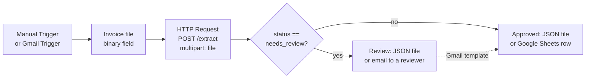

# n8n workflows

Two workflows that call the HTTP API (`docs/api.md`). They are checked with the `n8nio/n8n:2.45.7`
image: both import with `n8n import:workflow`, and the local one runs with `n8n execute`.

| File | What it does | Credentials |
|---|---|---|
| `invoice-pilot-local.json` | Manual Trigger → read an invoice file → `POST /extract` → IF `needs_review` → write the JSON result to `approved-…` or `needs_review-…` | none: environment variables only |
| `invoice-pilot-gmail-sheets.json` | Gmail Trigger (unread mail with an invoice attachment) → `POST /extract` → IF `needs_review` → email a reviewer → append a row to Google Sheets | placeholders to replace |



## Local workflow (no external accounts)

Start the API with the fake model (`LLM_FAKE=1`: no model key, no model call), then run n8n
on the same Docker network:

```sh
# .env: API_TOKEN=change-me and LLM_FAKE=1
docker compose up -d api

docker run --rm --network invoice-pilot_default \
  -v "$PWD/examples/invoices:/files/invoices:ro" \
  -v "$PWD/n8n-results:/files/results" \
  -v "$PWD/examples/n8n:/wf:ro" \
  -e N8N_RESTRICT_FILE_ACCESS_TO=/files \
  -e N8N_BLOCK_ENV_ACCESS_IN_NODE=false \
  -e INVOICE_PILOT_URL=http://api:8080 \
  -e INVOICE_PILOT_API_TOKEN=change-me \
  -e INVOICE_PILOT_FILE=/files/invoices/inv-007.pdf \
  --entrypoint sh n8nio/n8n:2.45.7 \
  -c 'n8n import:workflow --input=/wf/invoice-pilot-local.json && n8n execute --id InvPilotLocal001'
```

The result appears in `n8n-results/` (create the folder first) as `approved-invoice-<id>.json` or
`needs_review-invoice-<id>.json`. The Write node does not create folders.

With `LLM_FAKE=1`, each sample takes a known branch (see `examples/invoices/README.md`):

| `INVOICE_PILOT_FILE` | Status | Branch, result file |
|---|---|---|
| `/files/invoices/inv-001.pdf` | `auto_approved` | approved, `approved-invoice-<id>.json` |
| `/files/invoices/inv-005.jpg` | `auto_approved` | approved, `approved-invoice-<id>.json` |
| `/files/invoices/inv-007.pdf` | `needs_review` (`total_mismatch`) | review, `needs_review-invoice-<id>.json` |

| Variable | Meaning |
|---|---|
| `INVOICE_PILOT_URL` | Base URL of the API (default `http://api:8080`) |
| `INVOICE_PILOT_API_TOKEN` | Value of `API_TOKEN` of the API |
| `INVOICE_PILOT_FILE` | Invoice to send (default `/files/invoices/inv-001.pdf`) |
| `N8N_RESTRICT_FILE_ACCESS_TO=/files` | n8n 2.x lets file nodes use `~/.n8n-files` only, unless this is set |
| `N8N_BLOCK_ENV_ACCESS_IN_NODE=false` | n8n 2.x blocks `$env` in expressions by default; this workflow reads its settings from `$env` |

To import it in the n8n editor instead: **Workflows → Import from File**, then set the same
environment variables on the n8n instance.

## Gmail → Google Sheets template

Import `invoice-pilot-gmail-sheets.json`, then in the editor:

1. **Credentials.** Create a *Gmail OAuth2*, a *Google Sheets OAuth2* and a *Bearer Auth*
   credential, the last one with `API_TOKEN` as the token. Select them in the nodes; the file
   holds only placeholder IDs (`REPLACE_WITH_…`), never real values.
2. **Extract invoice.** Set the URL of your API. It must be reachable from n8n over HTTPS,
   behind your reverse proxy. The node sends the first attachment (`attachment_0`).
3. **Notify reviewer.** Set the reviewer's address.
4. **Append to sheet.** Set the spreadsheet ID and create a sheet `Invoices` with the
   columns `document_id`, `status`, `issues`, `supplier`, `invoice_number`, `invoice_date`,
   `currency` and `total`.
5. Adjust the Gmail search (`label:invoices`) and activate the workflow.

Amounts arrive as decimal strings (for example `"4241.62"`). Keep the column as text, or
convert it in the sheet, so no float rounding is introduced.
